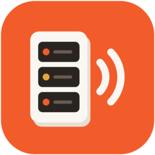

<p align="center">
  <picture>
    <source media="(prefers-color-scheme: dark)" srcset="docs/logo-dark.png">
    
  </picture>
</p>

<h1 align="center">yoto-proxy</h1>

Put your own music and audiobooks on Yoto "Make Your Own" cards, streamed
from your home server instead of uploaded.

- **Navidrome**: playlists and albums become Yoto playlists.
- **Audiobookshelf**: books become Yoto playlists with one track per chapter.
- **Families**: each person connects their own Yoto account, or shares one
  by invite link. Everyone browses their own libraries.

```
Yoto player ──HTTPS──▶ reverse proxy ──▶ yoto-proxy ──▶ Navidrome (Subsonic API)
                                             │      └──▶ Audiobookshelf API (+ ffmpeg)
                                             └──▶ Yoto API (create/update playlists, covers)
```

## How it works

Yoto playlists can contain **stream tracks**: URLs the player fetches when a
card is played. yoto-proxy creates Yoto playlists whose tracks point back at
itself (`https://<host>/s/<card-token>/<n>.mp3`) and serves each request from
Navidrome or Audiobookshelf.

- **Streaming.** MP3 files are passed through untouched with Range support.
  Other Navidrome formats are transcoded to MP3. Audiobook chapters inside
  larger files (e.g. m4b) are cut with ffmpeg into an on-disk cache in the
  background; until a chapter is cached it is rendered live.
- **Stream links** are the only credential the player has, so each card gets
  its own random token, which can be rotated from the UI.
- **Sync** re-reads the source and updates the same Yoto playlist, so a
  physical card linked to it picks up changes.
- **Card art** is rendered portrait (5:8, like a Yoto card) with the album art
  centered on a blurred background.
- **Linking a physical card** happens in the Yoto app: open the playlist in your
  library and link it to a blank Make Your Own card.

### Accounts

- **Login** to the web UI is via OpenID Connect (e.g. Pocket ID).
- **Yoto**: each user connects a Yoto account through Yoto's OAuth. Users who
  connect the same Yoto account, or accept an invite link (single use, 7
  days), share it and its cards.
- **Navidrome**, two modes:
  - `password`: one service account for everyone.
  - `header` (recommended): yoto-proxy acts as each logged-in user via
    Navidrome's external auth (`ExtAuth`). It connects from a dedicated
    loopback address (default `127.0.0.2`), and only that address is trusted.
    The OIDC `preferred_username` must match the Navidrome username, or be
    mapped with `NAVIDROME_USER_MAP`.
- **Audiobookshelf**: users connect through Audiobookshelf's own OpenID login
  (the mobile-app flow). For admins, yoto-proxy creates a non-expiring API key
  named `yoto-proxy (date)`. Other users get session tokens that are refreshed
  daily.
- **Cards** always stream with their creator's Navidrome/Audiobookshelf access.

## Setup

1. **Yoto developer app**: register a *Confidential Client* at
   <https://dashboard.yoto.dev>.
   - Callback URL: `https://<host>/auth/yoto/callback`.
   - Scopes: `user:content:view`, `user:content:manage`, `user:icons:manage`,
     `offline_access`.
2. **OIDC client** (e.g. Pocket ID): callback `https://<host>/auth/callback`.
3. **Navidrome, header mode**: set `ExtAuth.TrustedSources = "127.0.0.2/32"`.
   - Never trust the address your reverse proxy connects from.
   - As an extra safeguard, strip `Remote-User` from incoming requests in the
     reverse proxy in front of Navidrome.
4. **Audiobookshelf** (optional):
   - Add `https://<host>/auth/abs/callback` to *Settings → Authentication →
     Allowed Mobile Redirect URIs*.
   - Make sure Audiobookshelf's own OIDC client allows
     `https://<audiobookshelf>/auth/openid/mobile-redirect`.
5. **Make yoto-proxy reachable from the internet over HTTPS.** Yoto players
   fetch the stream URLs themselves.

## NixOS

```nix
# flake.nix
inputs.yoto-proxy = {
  url = "github:Solidsilver/yoto-proxy";
  inputs.nixpkgs.follows = "nixpkgs";
};

# configuration
{ inputs, config, ... }:
{
  imports = [ inputs.yoto-proxy.nixosModules.default ];

  # KEY=value lines: YOTO_CLIENT_SECRET, OIDC_CLIENT_SECRET
  # (and NAVIDROME_PASSWORD in password mode)
  age.secrets.yoto-proxy.file = ./secrets/yoto-proxy.age;

  services.yoto-proxy = {
    enable = true;
    publicUrl = "https://yoto.example.com";
    environmentFile = config.age.secrets.yoto-proxy.path;
    yoto.clientId = "<from dashboard.yoto.dev>";
    oidc = {
      issuer = "https://auth.example.com";
      clientId = "<from your identity provider>";
    };
    navidrome.auth = "header";
    audiobookshelf.publicUrl = "https://shelf.example.com"; # optional
  };

  services.navidrome.settings.ExtAuth.TrustedSources = "127.0.0.2/32";
}
```

- **Reverse proxy**: point it at `127.0.0.1:3614`.
- **State**: everything lives in `dataDir` (default `/var/lib/yoto-proxy`): a
  SQLite database and the chapter cache. Back it up like any other state.
- **Secrets**: systemd reads `environmentFile` as root, so a root-only agenix
  file works.

## Configuration

| Env var | Default | Notes |
| --- | --- | --- |
| `LISTEN_ADDR` | `127.0.0.1:3614` | |
| `PUBLIC_URL` | `http://localhost:3614` | Must be reachable by Yoto players |
| `DATA_DIR` | `./data` | SQLite database and chapter cache |
| `YOTO_CLIENT_ID`, `YOTO_CLIENT_SECRET[_FILE]` | | Secret optional for public clients |
| `OIDC_ISSUER`, `OIDC_CLIENT_ID`, `OIDC_CLIENT_SECRET[_FILE]` | | Web UI login |
| `NAVIDROME_URL` | `http://127.0.0.1:4533` | |
| `NAVIDROME_AUTH` | `password` | `password` or `header` |
| `NAVIDROME_USER`, `NAVIDROME_PASSWORD[_FILE]` | | Password mode |
| `NAVIDROME_USER_HEADER` | `Remote-User` | Header mode |
| `NAVIDROME_SOURCE_ADDR` | | Header mode: local IP to connect from |
| `NAVIDROME_USER_MAP` | | Header mode: `login=navidrome,...` |
| `TRANSCODE_BITRATE` | `192` | kbps, for non-MP3 music |
| `ABS_PUBLIC_URL` | | Enables Audiobookshelf |
| `ABS_URL` | `http://127.0.0.1:13378` | |
| `ABS_BITRATE` | `64` | kbps mono, for re-encoded chapters |
| `FFMPEG_PATH` | `ffmpeg` | |
| `AUTH_DISABLED` | `false` | Local development only |

## Development

```sh
# backend (auth disabled; logged in as "dev")
AUTH_DISABLED=true YOTO_CLIENT_ID=... YOTO_CLIENT_SECRET=... \
NAVIDROME_USER=... NAVIDROME_PASSWORD=... \
go run ./cmd/yoto-proxy            # :3614

# frontend with hot reload (proxies /api, /auth, /s to :3614)
cd web && pnpm install && pnpm dev
```

- `go build` embeds `web/build`, so run `pnpm build` in `web/` first, or use
  `nix build`.
- Tests: `go test ./...`, and `pnpm check` in `web/`.
- Icons: the logo is drawn in `tools/make_icons.py`; run
  `python3 -I tools/make_icons.py` (needs ImageMagick and Pillow) to
  regenerate every icon, the README logo and the social preview.
- The Yoto developer app also needs `http://localhost:3614/auth/yoto/callback`
  as a callback URL for local testing.

## License

MIT — see [LICENSE](LICENSE).
